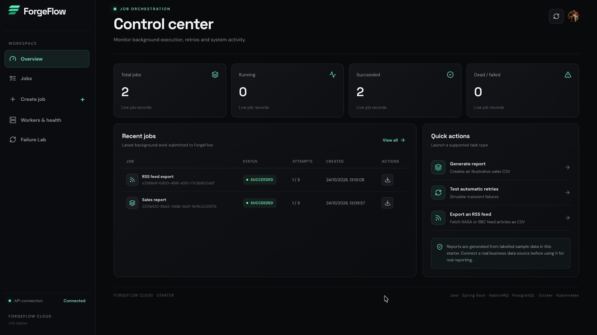
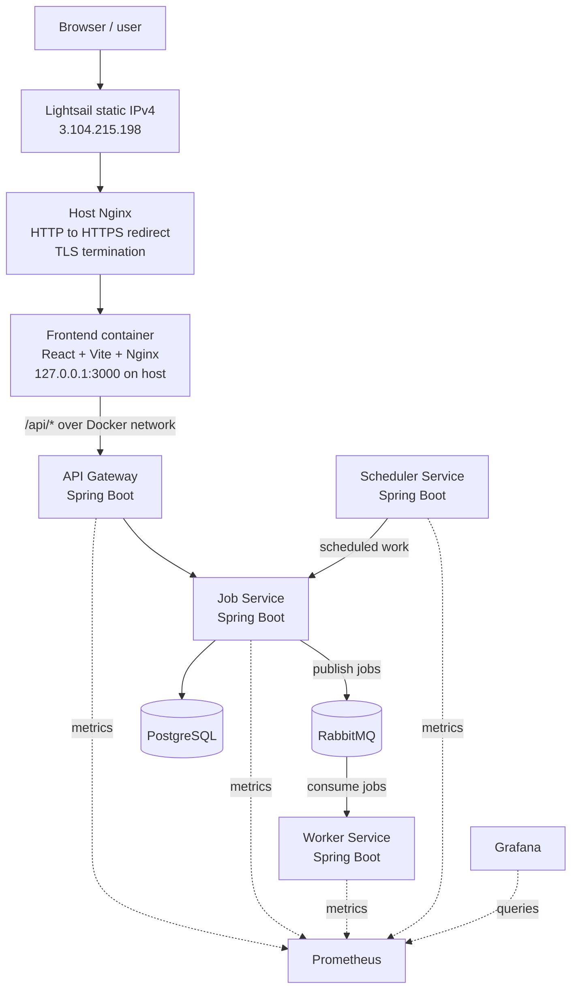

# ForgeFlow Cloud — distributed background job platform

ForgeFlow is a portfolio-ready **starter monorepo** for a developer-focused background job platform. Engineers submit supported jobs through an HTTP API; ForgeFlow persists them, places them on RabbitMQ, executes them in Java workers, retries eligible failures, records execution history and exposes a dashboard for visibility.

> **Current scope:** This repository includes an end-to-end MVP path for `GENERATE_REPORT` (clearly labelled synthetic sales data) and `SIMULATE_FAILURE` (controlled retry testing). It is a learning/portfolio starter, not production banking/payment infrastructure or a production-hardened multi-tenant SaaS. Review the security and deployment notes before exposing it beyond a local machine.

## Architecture

```text
React + TypeScript + Clerk (optional for local preview)
              │  /api/*
              ▼
      Spring Cloud API Gateway
              │
              ▼
       Job Service (Java)
        │            │
        │            ├── PostgreSQL: jobs, attempts, workers, outbox
        │
        └── transactional outbox publisher
                     │
                     ▼
                  RabbitMQ
                     │
                     ▼
          Worker Service (Java)
          ├── GENERATE_REPORT → CSV artifact
          └── SIMULATE_FAILURE → controlled retries

 Scheduler Service ── calls internal scheduler endpoint on Job Service
 Prometheus ── scrapes Actuator metrics ── Grafana dashboards
 Docker Compose ── local orchestration
 Kubernetes manifests ── deployment/HPA starter
 GitHub Actions ── CI build/test workflow
```

### Repository layout

```text
ForgeFlow-Cloud/
├── frontend/                 React + TypeScript + Vite + Clerk
├── services/
│   ├── api-gateway/          Spring Cloud Gateway
│   ├── job-service/           REST API, persistence, outbox, retries and admin endpoints
│   ├── worker-service/        RabbitMQ consumer and task handlers
│   └── scheduler-service/     scheduled-job dispatch and lease recovery trigger
├── infra/
│   ├── prometheus/            metrics scraping config
│   └── grafana/               datasource and starter dashboard provisioning
├── k8s/forgeflow.yaml         Kubernetes workloads, services, PVCs and worker HPA
├── .github/workflows/ci.yml   frontend/backend CI
├── docs/API.md                API reference and example payload
├── docker-compose.yml         local full-stack environment
└── pom.xml                    Maven parent/aggregator (Java 21)
```

## Quick start (recommended: Docker Compose)

Prerequisites: Docker Desktop (or Docker Engine + Compose plugin), approximately 4 GB RAM available to Docker, and a little patience while Maven/npm images build for the first time.

1. Extract this ZIP and open a terminal in the `ForgeFlow-Cloud` root.
2. Copy the example environment file:

   ```bash
   cp .env.example .env
   ```

3. Start the full stack:

   ```bash
   docker compose up --build
   ```

4. Open the services below.

| UI/service | Local URL | Notes |
|---|---|---|
| ForgeFlow UI | http://localhost:3000 | Local preview works without Clerk keys |
| API Gateway | http://localhost:8080 | Public `/api/*` routes |
| Job Service health | http://localhost:8081/actuator/health | Local development only; don't expose directly in production |
| Worker health | http://localhost:8082/actuator/health | Internal service, port not published by Compose |
| Scheduler health | http://localhost:8083/actuator/health | Local scheduler service |
| RabbitMQ management | http://localhost:15672 | Default local user/password: `forgeflow` / `forgeflow_dev` |
| Prometheus | http://localhost:9090 | Scrapes Spring Actuator metrics |
| Grafana | http://localhost:3001 | Default local user/password: `admin` / `admin_dev_change_me` |

The defaults in `.env.example` are **for local development only**. Change every password and the internal token before sharing the stack with anyone. Do not put production credentials in git.

Useful commands:

```bash
docker compose ps
docker compose logs -f job-service worker-service scheduler-service
docker compose down
# Destructive: also deletes Postgres/RabbitMQ/metrics volumes
docker compose down -v
```

### Try an end-to-end job

1. In the UI click **Open local demo workspace** (labelled local preview; it is not authentication).
2. Choose **Create job → Generate sales report → Submit job**.
3. Look at Job Explorer. The job will pass through `QUEUED`, `RUNNING`, and `SUCCEEDED` if the stack is healthy.
4. Download the CSV from the completed job. The generated report explicitly says **SAMPLE DATA ONLY**; no real sales data is claimed.
5. Open Failure Lab, configure `SIMULATE_FAILURE` with `failFirstAttempts=2` and `maxAttempts=3`. Watch it fail twice and succeed on the third attempt.
6. Open Workers & health. The endpoint lists worker heartbeats when run in local development mode.

If the browser shows a backend error, verify the containers and logs first. The dashboard does not fabricate API success or metrics.

## Run the frontend separately

Requires Node.js 22+ and npm:

```bash
cd frontend
npm install
cp .env.example .env.local
npm run dev
```

Vite proxies `/api` to `http://localhost:8080`. To configure Clerk for real sign-in, set `VITE_CLERK_PUBLISHABLE_KEY` in `frontend/.env.local` and in the **root `.env`** before building through Compose. Then enable Google social sign-in in Clerk and set the correct development/production allowed origins and redirects.

The UI preview without a Clerk key is explicitly unauthenticated and suitable only for local demos. It must not be deployed as a public workspace.

## Google authentication and backend security

The frontend uses Clerk's React SDK. Real Google sign-in requires:

1. Create a Clerk application and enable Google as a social connection.
2. Configure allowed origins/redirect URLs for the local and deployed frontend.
3. Set `VITE_CLERK_PUBLISHABLE_KEY` (frontend-visible key; never a secret key).
4. For backend JWT validation, set `FORGEFLOW_SECURITY_ENABLED=true` and `CLERK_ISSUER_URI` to your Clerk issuer URL.
5. Configure Clerk session/JWT claims so administrators receive `role: "admin"` or `org_role: "admin"` for the admin endpoints.

**Important:** Compose defaults to `FORGEFLOW_SECURITY_ENABLED=false` only so the project can be tried locally without external accounts. In this mode the backend intentionally permits unauthenticated development requests and maps them to a `local-dev` owner. Never expose that mode to the internet. In secured mode, the Job Service validates JWTs; user-facing job queries are owner-scoped and the global admin endpoints require the admin claim. Gateway routing is not a substitute for backend authorization.

The internal service token (`FORGEFLOW_INTERNAL_TOKEN`) protects worker/scheduler calls. Change it for non-local deployments and restrict network access to internal endpoints. Also add rate limits, secrets management, audit controls and stricter network policies before any public deployment.

## Job behavior

- `GENERATE_REPORT` creates an illustrative CSV with synthetic deterministic figures and `SAMPLE DATA ONLY` labels. It is deliberately not connected to real business data.
- `SIMULATE_FAILURE` intentionally fails the requested number of attempts for exercising retry behavior.
- `maxAttempts` is between 1 and 10. The first execution counts as attempt 1.
- Retries use exponential backoff (2, 4, 8 seconds, capped at 60 seconds).
- The Job Service writes the job and outbox event in one database transaction. A publisher asynchronously delivers outbox events to RabbitMQ.
- Worker claims are conditional status changes; a worker must hold the current lease to complete/fail a running job.
- The Scheduler Service asks the Job Service to dispatch due scheduled/retry jobs and recover expired worker leases.
- `DEAD` means automatic attempts were exhausted. An administrator can inspect the error and manually retry.
- The shared `data/reports` directory is used for downloaded report artifacts in local Compose.

## API and development

See [`docs/API.md`](docs/API.md) for the API routes and payload. Main routes:

- `POST /api/jobs`
- `GET /api/jobs`, `GET /api/jobs/{id}`, `GET /api/jobs/{id}/attempts`
- `GET /api/jobs/{id}/result`, `POST /api/jobs/{id}/cancel`
- `GET /api/dashboard/summary`
- Admin: `GET /api/admin/summary`, `/api/admin/jobs`, `/api/admin/workers`, `POST /api/admin/jobs/{id}/retry`

All internal endpoints are under `/internal/**`; the gateway deliberately does not route them. Internal endpoints require `X-Internal-Token`.

### Build backend locally

Requires Java 21 and Maven 3.9+:

```bash
mvn -B verify
```

### Build frontend locally

```bash
cd frontend && npm install && npm run build
```

## Docker, Kubernetes and CI/CD

- Dockerfiles use a Maven build stage and a Java 21 runtime stage for each service.
- `docker-compose.yml` starts PostgreSQL, RabbitMQ, all backend services, the frontend, Prometheus and Grafana.
- `k8s/forgeflow.yaml` is a Kubernetes **starter manifest**, not a one-command managed production deployment. Before applying it, build and push images and replace `ghcr.io/YOUR_ORG/...`, set all secrets, configure Clerk's issuer, and inspect storage classes/ingress/network policies.
- The reports PVC in the sample uses `ReadWriteOnce`, which suits many single-node local clusters. A multi-node cluster should use object storage (for example, an S3-compatible bucket) or a shared filesystem that supports the required access mode. Do not assume a default storage class supports shared volumes.
- The worker HPA uses CPU metrics and requires Kubernetes Metrics Server. Queue-depth scaling needs a custom/external metrics adapter and additional configuration.
- `.github/workflows/ci.yml` builds frontend/backend on push and pull request. The workflow does not automatically publish images or deploy to a cluster.

## Monitoring

Spring Boot Actuator and Micrometer expose `/actuator/prometheus` in each service. Prometheus scrapes the service endpoints and Grafana is provisioned with a starter HTTP/service-health dashboard. Queue depth and per-job business counters can be added as custom Micrometer metrics; the initial dashboard only plots metrics the services currently expose.

## Design decisions and current limitations

This is a working MVP architecture scaffold; harden it before presenting it as production-ready:

- PostgreSQL `ddl-auto: update` is for development. Use Flyway/Liquibase migrations in a real deployment.
- Use row-level locking/`SKIP LOCKED` or a dedicated distributed scheduler lock before scaling the scheduler/outbox publisher beyond one instance.
- Add idempotency at the **business side-effect handler**, not just at API job creation; message delivery is at-least-once and exactly-once execution is not claimed.
- The demo report has synthetic content. Integrate a permitted application/data source to generate business reports with real values.
- Add integration tests for RabbitMQ/PostgreSQL (for example, Testcontainers), load tests, audit logging, explicit admin/user role provisioning, CORS/CSRF review, and artifact retention before production.
- Docker build/test has not been executed in this authoring environment. After download, run the commands above and use `docker compose logs` to debug environment-specific issues.

## Suggested implementation milestones

1. Run the stack and verify report + simulated failure jobs.
2. Add tests for job transitions, retries, cancellation, idempotency and worker lease recovery.
3. Add Flyway migrations and Testcontainers integration tests.
4. Add real task handlers through explicit allow-listed `JobHandler` implementations.
5. Configure Clerk authentication + admin claim and test owner isolation.
6. Benchmark job throughput/latency under documented workloads; report measurements from actual tests only.
7. Deploy to a test Kubernetes cluster and add queue-depth metrics/scaling only after CPU-based scaling works.

## AWS Deployment

**Live demo:** [https://3.104.215.198](https://3.104.215.198)
**Hosting:** AWS Lightsail · Ubuntu 22.04 LTS · 8 GB RAM · 2 vCPUs · 160 GB SSD
**Region:** Asia Pacific (Sydney), `ap-southeast-2`
**Deployment:** Docker Compose, host-level Nginx reverse proxy, Let's Encrypt IP-address TLS certificate

### Live application



### Cloud architecture



### Deployment steps

1. **Provision the VM.** Create an Ubuntu 22.04 LTS Lightsail instance and attach a static IPv4 address.
2. **Restrict inbound traffic.** Allow public TCP ports `80` (HTTP) and `443` (HTTPS). Restrict SSH (`22`) to an administrator's IP address and/or the Lightsail browser SSH client. Keep database, message-broker, backend and monitoring ports private.
3. **Install Docker Engine and Docker Compose.** Use Docker's official Ubuntu repository.
4. **Get the source.** Clone this repository onto the instance and check out the intended deployment commit.
5. **Create server-only configuration.** Create `.env` on the server with strong unique passwords/tokens and the required Clerk settings. Set permissions with `chmod 600 .env`. Never commit `.env` or put real secrets in this README.
6. **Validate Compose configuration.** Run `docker compose config --quiet` before starting services.
7. **Build and start the stack.** Run `sudo docker compose up --build -d`, then inspect service health with `sudo docker compose ps` and logs with `sudo docker compose logs --tail=100`.
8. **Publish the frontend through Nginx.** The host Nginx proxy serves public traffic on ports `80`/`443` and forwards it to the frontend container bound to `127.0.0.1:3000`. The frontend's container Nginx proxies `/api/` to the API gateway over the Docker network.
9. **Enable HTTPS.** Certbot obtains a Let's Encrypt short-lived certificate for the static IP through the ACME HTTP webroot challenge. HTTP requests redirect to HTTPS.
10. **Automate renewal.** The IP-address certificate is valid for 160 hours (a little over six days). Keep the Certbot renewal timer enabled and use a deploy hook to reload Nginx after successful renewal. Test renewal with `sudo certbot renew --dry-run`.
11. **Smoke-test the deployment.** Confirm the site loads over HTTPS, HTTP redirects to HTTPS, jobs can be submitted and completed, and RSS feed jobs generate downloadable CSVs.

### Operational and security notes

- Only the web entry point should be publicly reachable. PostgreSQL, RabbitMQ, Spring Boot services, Prometheus and Grafana should not be exposed directly to the public internet.
- The Compose file binds the frontend to host loopback (`127.0.0.1:3000`); host Nginx is the public entry point.
- Keep `.env` on the server, outside version control. Use `.env.example` for placeholder documentation only.
- The deployment currently uses an IP-address certificate rather than a custom domain. IP certificates use Let's Encrypt's `shortlived` profile and require dependable automated renewal. See [Let's Encrypt's IP and short-lived certificate announcement](https://letsencrypt.org/2026/01/15/6day-and-ip-general-availability) and the [Certbot renewal-hook documentation](https://eff-certbot.readthedocs.io/en/stable/using.html#renewing-certificates).
- Lightsail resources have ongoing charges. Check the current [Lightsail pricing](https://aws.amazon.com/lightsail/pricing/) and delete resources you no longer need.

### Useful production checks

```bash
# Run from the ForgeFlow repository directory on the Lightsail instance
sudo docker compose ps
sudo docker compose logs --tail=100
sudo nginx -t
curl -I https://3.104.215.198
curl -I http://3.104.215.198
sudo certbot renew --dry-run
```
